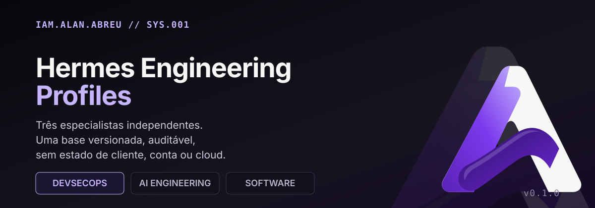
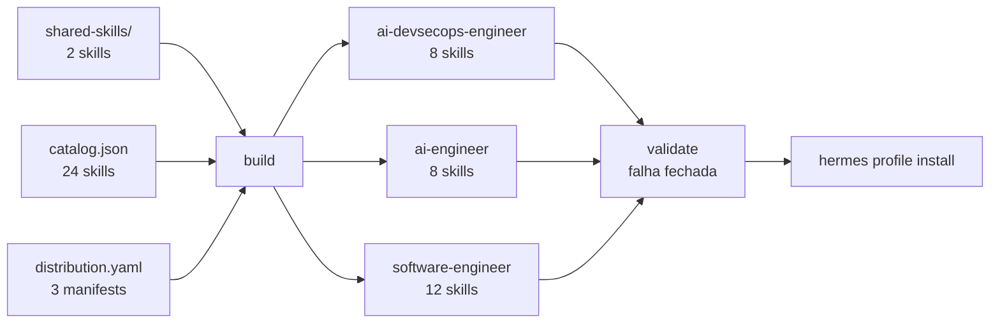
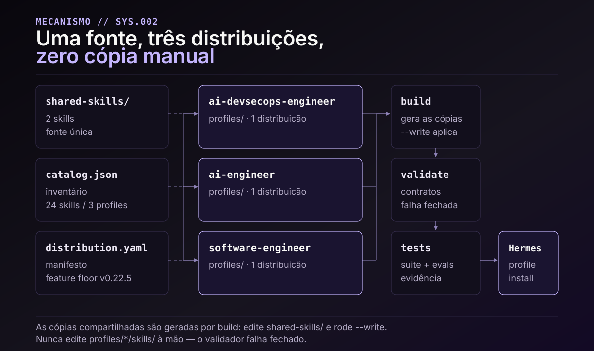
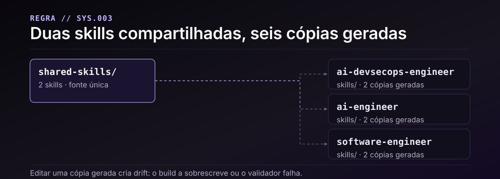
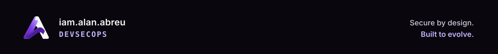

<p align="center">
  
</p>

<p align="center">
  <a href="QUICKSTART.md"></a>
  <a href="docs/CAPABILITY-MAP.md"></a>
  <a href="reports/QUALIFICATION.md"></a>
  
  
  <a href="https://www.iamalanabreu.com"></a>
</p>

**Três especialistas independentes sobre uma base versionada.** DevSecOps, AI Engineering e
Software Engineering, cada um com seu próprio `distribution.yaml`, instaláveis pelo mecanismo
nativo do Hermes. Sem cliente, conta, cloud, modelo ou framework fixo. Sem chave embutida.
Sem estado de runtime.

Não é uma coleção de prompts. É um conjunto de **24 skills canônicas** com contratos
verificáveis, um validador que falha fechado e uma suíte de 96 testes determinísticos.

---

## Os três especialistas

| Distribuição | Quando usar | Skills | Versão |
|---|---|---:|---|
| **[ai-devsecops-engineer](profiles/ai-devsecops-engineer/README.md)** | Mudança de infra, IAM/secrets, K8s/GitOps, incidente, supply chain | 8 | 0.1.0 |
| **[ai-engineer](profiles/ai-engineer/README.md)** | Agentes, roteamento de modelo, RAG/memória, avaliação, LLMOps | 8 | 0.1.0 |
| **[software-engineer](profiles/software-engineer/README.md)** | Full-stack, SaaS, contratos de API, qualidade, release | 12 | 0.1.0 |

Três `distribution.yaml`, três `config.yaml`, três `SOUL.md` — **não** três cópias de um mesmo
prompt. Cada perfil tem escopo, prioridades e limites próprios.



> Mermaid renderiza nativamente no GitHub. O `assets/readme/architecture.svg` carrega a mesma
> informação em versão estática e serve de fallback em viewers sem Mermaid.

---

## Como a base se sustenta

**Uma fonte, três distribuições, zero cópia manual.** As duas skills compartilhadas
(`agent-folder-architect`, `project-context-architect`) existem uma única vez em `shared-skills/`
e são **geradas** para dentro de cada profile pelo build.

<p align="center">
  
</p>

Editar uma cópia gerada cria drift: o próximo `--write` a sobrescreve ou o validador falha
fechado. Por isso a regra é explícita — **edite `shared-skills/`, nunca `profiles/*/skills/`**.

<p align="center">
  
</p>

| Camada | O que garante | Comando |
|---|---|---|
| Build | Cópias compartilhadas idênticas à fonte | `python3 scripts/build_distributions.py` |
| Validação | Manifests, frontmatter, links, segredos heurísticos | `python3 scripts/validate_distributions.py` |
| Testes | 96 contratos determinísticos, fixtures sintéticas | `python3 -m unittest discover -s tests` |
| Runtime | Instalação nativa em HOME descartável | `python3 scripts/smoke_native.py` |

`build_distributions.py` roda **check-only** por padrão. Gravar exige `--write`.

---

## Comece em três comandos

Requer um clone em caminho estável (o update nativo relê esse caminho) e um provider já
configurado no Hermes.

```sh
git clone git@github.com:iamalanabreu/hermes-engineering-profiles.git
cd hermes-engineering-profiles

hermes profile install ./profiles/software-engineer --name software-lab
hermes -p software-lab setup      # escolha somente providers e acessos autorizados
hermes -p software-lab chat
```

A raiz deste monorepositório **não** é instalável. Cada pasta em `profiles/` é.
`setup` não tem default de provider, modelo ou permissão — a configuração é sua decisão.

<details>
<summary><strong>Validar a árvore antes de instalar</strong></summary>

```sh
python3 -m pip install -r requirements-dev.txt

python3 scripts/build_distributions.py        # check-only, não grava
python3 scripts/validate_distributions.py     # contratos + integridade
mkdir -p .tmp && TMPDIR="$PWD/.tmp" python3 -m unittest discover -s tests -v
```

O `TMPDIR` importa no macOS: os testes recusam symlink no caminho do diretório temporário, e
tanto `/var` quanto `/tmp` são symlinks no sistema. `mkdir -p` é necessário — `tempfile` ignora
um `TMPDIR` que não existe e cai de volta em `/tmp`.

</details>

<details>
<summary><strong>Qualificação: o que foi executado e o que não foi</strong></summary>

[`reports/QUALIFICATION.md`](reports/QUALIFICATION.md) registra a execução real. Ela separa
quatro camadas que costumam ser confundidas:

1. **Contratos estáticos** — PASS/FAIL determinístico, sem modelo.
2. **Comportamento dos helpers** — 96 testes, fixtures sintéticas.
3. **Runtime nativo** — instala em HOME descartável; ausência do binário fica `BLOCKED`, nunca `PASS`.
4. **Comportamento do modelo** — 78 casos em `evals/cases.jsonl`, **não executados**.

A camada 4 é a que mais importa e é a que não roda em CI. Um dataset de avaliação não é
uma avaliação. Ver [KNOWN-LIMITS](docs/KNOWN-LIMITS.md).

</details>

---

## O que este repositório não faz

Honestidade sobre limites é parte do design:

- **Não** promete sandbox por profile. `config.yaml` traz `approvals.mode: manual`, mas isso
  é política de configuração, não fronteira de kernel.
- **Não** promete obediência perfeita do modelo. Skills orientam; não compilam garantias.
- **Não** inclui credencial, chave, token ou estado de runtime — em nenhum nível.
- **Não** é um release oficial do Nous Research. É uma base própria sobre o Hermes.
- **Não** tem avaliação de modelo executada. Os 78 casos estão escritos, não rodados.

Detalhes em [SECURITY](docs/SECURITY.md) e [KNOWN-LIMITS](docs/KNOWN-LIMITS.md).

---

## Estrutura

```text
hermes-engineering-profiles/
├── catalog.json              inventário canônico: 24 skills, 3 profiles
├── shared-skills/            fonte única das 2 skills compartilhadas
├── profiles/
│   ├── ai-devsecops-engineer/   distribution.yaml · config.yaml · SOUL.md · skills/
│   ├── ai-engineer/
│   └── software-engineer/
├── scripts/                  build · validate · qualify · install · package
├── tests/                    96 contratos determinísticos
├── evals/                    78 casos escritos, NÃO executados
├── docs/                     arquitetura · segurança · limites · processo de release
├── reports/                  qualificação executada, com evidência
└── assets/readme/            SVG do design system + gerador + auditor
```

---

## Manutenção

Edite `shared-skills/` para as duas compartilhadas, edite skills técnicas dentro do próprio
profile, e então:

```sh
python3 scripts/build_distributions.py --write
git diff                     # revise cada cópia alterada
python3 scripts/validate_distributions.py
mkdir -p .tmp && TMPDIR="$PWD/.tmp" python3 -m unittest discover -s tests
```

Drift local em cópia gerada é **conflito**, não permissão para apagar. O
[processo de release](docs/RELEASE-PROCESS.md) descreve a publicação revisada.

Assets visuais regeneráveis:

```sh
python3 assets/readme/generate.py              # reescreve os 7 SVG a partir dos tokens
python3 assets/readme/audit.py assets/readme   # falha se um conector cruzar texto
```

---

## Documentação

| Documento | Para quê |
|---|---|
| [QUICKSTART](QUICKSTART.md) | Instalar e validar uma instância nomeada |
| [CAPABILITY-MAP](docs/CAPABILITY-MAP.md) | Escolher o especialista pela tarefa |
| [CONTEXT-STRATEGY](docs/CONTEXT-STRATEGY.md) | Adaptar contexto por projeto |
| [ARCHITECTURE](docs/ARCHITECTURE.md) | Como as camadas se relacionam |
| [SECURITY](docs/SECURITY.md) | Modelo de confiança e limites reais |
| [KNOWN-LIMITS](docs/KNOWN-LIMITS.md) | O que não foi testado |
| [UPGRADING](docs/UPGRADING.md) | Atualizar sem perder config |
| [QUALIFICATION](reports/QUALIFICATION.md) | Evidência do que rodou |
| [CHANGELOG](CHANGELOG.md) | Histórico de mudanças |

## Onde este trabalho vive

Este repositório é a base; o contexto mais amplo do trabalho está em
**[iamalanabreu.com](https://www.iamalanabreu.com)** — a mesma identidade `DEVSECOPS`, os mesmos
tokens, os mesmos princípios editoriais.

| Superfície | Conteúdo |
|---|---|
| [iamalanabreu.com](https://www.iamalanabreu.com) | Home: Engineering is a system, APDA, production showcase |
| [/architecture](https://www.iamalanabreu.com/architecture) | Diagramas de sistema: Internal Developer Platform, Secure Delivery Pipeline |
| [/adr](https://www.iamalanabreu.com/adr) | Record de decisão arquitetural — ADR-001 a ADR-006 |
| [/stack](https://www.iamalanabreu.com/stack) | Stack e ferramentas em uso |
| [/about](https://www.iamalanabreu.com/about) | Perfil profissional |
| [GitHub @iamalanabreu](https://github.com/iamalanabreu) | Código |

O site e este repositório compartilham a paleta oficial — Ink `#09070D`, Purple 700 `#5B21B6`,
Purple 500 `#7C3AED`, Lavender `#C4B5FD` — e as assinaturas editoriais
*Secure by design. Built to evolve.* e *Complex systems. Clearly expressed.*

---

## English summary

Three independent specialists — DevSecOps, AI Engineering, Software Engineering — on one
versioned base. Each is a native Hermes distribution with its own manifest, config and soul;
none shares a prompt.

- **24 canonical skills**: 22 technical plus 2 shared, generated into all three profiles (28 copies).
- **One source, three distributions**: shared skills are authored once in `shared-skills/` and
  generated by the build. Never edit `profiles/*/skills/` by hand — the validator fails closed.
- **Verification over claims**: static contracts, 96 deterministic tests, native install smoke
  in a disposable HOME. The 78 model-evaluation cases are written but **not executed**; a dataset
  is not an evaluation.
- **No credentials, no model lock-in, no runtime state** ship in the source.
- **Not** an official Nous Research release, and **not** a per-profile sandbox.

Install from a stable clone path:

```sh
hermes profile install ./profiles/software-engineer --name software-lab
hermes -p software-lab setup
hermes -p software-lab chat
```

Baseline: Hermes v0.22.5. License MIT. See [docs/](docs/) and [NOTICE.md](NOTICE.md) for provenance.

---

<p align="center">
  
</p>
