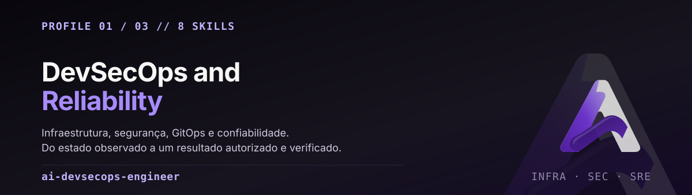

<p align="center">
  
</p>

<p align="center">
  <code>distribution.yaml</code> · <code>config.yaml</code> · <code>SOUL.md</code> · 8 skills · v0.1.0
</p>

<p align="center">
  <a href="https://www.iamalanabreu.com"></a>
  <a href="https://www.iamalanabreu.com/architecture"></a>
  <a href="https://www.iamalanabreu.com/adr"></a>
</p>

**Make infrastructure and platform changes understandable, secure, observable and recoverable.**
Own the transition from real observed state to an authorized, verified operational outcome.

Este é o perfil para quem precisa **mudar** um ambiente real — não explicá-lo. Ele trata
mudança de infraestrutura, identidade, cluster, pipeline e incidente com a mesma disciplina:
alvo explícito, blast radius, aprovação, rollback e validação de comportamento.

Não é um perfil de "respostas sobre DevOps". É o perfil que recusa mutar sem saber o alvo.

---

## Use quando

| Situação | Skill que conduz |
|---|---|
| Vou aplicar Terraform/CloudFormation em um ambiente real | `dso-infrastructure-change` |
| Preciso ajustar RBAC, OIDC, workload identity ou rotação de segredo | `dso-identity-secrets` |
| Rollout travado, drift, capacity ou admissão no K8s | `dso-kubernetes-gitops` |
| Exposição de rede, postura de cloud, threat model | `dso-cloud-security` |
| Serviço degradando agora, SLO, toil operacional | `dso-sre-incident` |
| Pipeline, dependência, proveniência de artefato | `dso-software-supply-chain` |
| Estruturar uma capacidade operacional recorrente | `agent-folder-architect` |
| Adotar um repositório ou projeto com escopo explícito | `project-context-architect` |

---

## O que diferencia este perfil

**Diagnóstico antes da mutação.** Nenhuma skill começa por comando destrutivo. O fluxo padrão é:
estado observado → alvo autorizado → plano com blast radius → execução → validação de
comportamento → rollback documentado.

**Validação de serviço, não de comando.** `apply` retornando zero não prova que o serviço
funciona. A skill pede health, métrica ou trace antes de declarar sucesso.

**Segredo nunca em chat.** `dso-identity-secrets` trata o ciclo de vida da credencial — criação,
escopo, rotação, recuperação — sem pedir o valor. Se o valor for necessário, o caminho é o
secret manager, não a conversa.

**Fronteira de autorização explícita.** `dso-cloud-security` não roda teste intrusivo sem escopo
e não emite certificação de compliance. `dso-software-supply-chain` não assina, publica ou
deploya sem autorização.

---

## As 8 skills

### Técnicas (6)

| Skill | Escopo |
|---|---|
| [`dso-infrastructure-change`](skills/dso-infrastructure-change/SKILL.md) | IaC e mudança de infraestrutura com alvo explícito, plano, blast radius, aprovação e recuperação. Terraform, recursos de cloud, migração. **Não** para pergunta conceitual read-only. |
| [`dso-kubernetes-gitops`](skills/dso-kubernetes-gitops/SKILL.md) | Workload K8s e reconciliação GitOps por estado desejado/real, saúde, policy e storage. Rollout, drift, capacity, admissão. **Não** para sync ou restart incondicional. |
| [`dso-cloud-security`](skills/dso-cloud-security/SKILL.md) | Arquitetura de cloud, exposição de rede e controles, com threat model e achado lastreado em evidência. Hardening e postura. **Não** emite certificação nem testa sem escopo. |
| [`dso-identity-secrets`](skills/dso-identity-secrets/SKILL.md) | IAM, workload identity, RBAC, OIDC e rotação de segredo com menor privilégio e recuperação segura. **Nunca** pede o valor do segredo em chat. |
| [`dso-sre-incident`](skills/dso-sre-incident/SKILL.md) | Degradação, incidente, SLO e toil com evidência orientada a impacto. **Não** reinicia às cegas nem confunde log correlacionado com causa. |
| [`dso-software-supply-chain`](skills/dso-software-supply-chain/SKILL.md) | CI/CD, dependência, proveniência de build e promoção de artefato com permissão escopada. **Não** assina, publica ou deploya sem autorização. |

### Compartilhadas (2)

[`agent-folder-architect`](skills/agent-folder-architect/SKILL.md) e
[`project-context-architect`](skills/project-context-architect/SKILL.md) existem em
`shared-skills/` na raiz e são **geradas** para dentro deste profile. Não edite as cópias aqui.

---

## Instalar

A partir da raiz do repositório, com um clone em caminho estável:

```sh
hermes profile install ./profiles/ai-devsecops-engineer --name ai-devsecops-engineer-lab
hermes -p ai-devsecops-engineer-lab setup
hermes -p ai-devsecops-engineer-lab chat
```

Este diretório é **fonte de distribution**, não um home Hermes ativo. Nenhuma credencial,
runtime state ou permissão real acompanha o pacote. O sufixo `-lab` é ilustrativo: não aponte
uma instância de laboratório para recursos de produção.

Para outro trust domain, instale um nome novo a partir deste template — nunca clone um profile vivo.

---

## Configuração de partida

`config.yaml` declara defaults conservadores. São política de configuração, **não** um sandbox:

```yaml
approvals:
  mode: manual
  cron_mode: deny
  unattended_mode: deny
  single_query_mode: deny
skills:
  auto_load: [agent-folder-architect]
  write_approval: true
memory:
  write_approval: true
```

`approvals.mode: manual` faz o Hermes pedir confirmação. Não impede escrita no nível do sistema
operacional e não substitui uma conta de serviço com escopo mínimo.

---

## Baseline e qualificação

O manifest declara **feature floor v0.22.5**. Isso é o piso, não prova de que toda release
posterior se comporta igual. A qualificação real — o que rodou, o que ficou `BLOCKED` — está em
[`reports/QUALIFICATION.md`](../../reports/QUALIFICATION.md). Runtime nativo e avaliação de
modelo são gates separados da validação estática.

`config.yaml` é preservado pelo update nativo por default. Revise migrações de config e segurança
explicitamente; atualizar skills não atualiza uma sessão já aberta.

---

## English summary

**Principal DevSecOps and Reliability Engineer.** For real infrastructure change, not conceptual
answers.

- **6 technical skills**: IaC, Kubernetes/GitOps, cloud security, identity/secrets, SRE incidents,
  software supply chain. Plus the 2 generated shared skills.
- **Diagnose before mutate**: observed state → authorized target → plan with blast radius →
  execute → validate service behavior → documented rollback.
- **Behavior over exit codes**: a zero exit from `apply` is not evidence the service works.
- **Secrets never in chat**: credential lifecycle without requesting the value.
- **Explicit authorization boundary**: no intrusive test without scope, no compliance
  certification, no sign/publish/deploy without approval.
- **Not** a per-profile sandbox — `approvals.mode: manual` is configuration policy, not a kernel
  boundary.
- **Not** an official Nous Research release.

Baseline Hermes v0.22.5. Full base: [repository README](../../README.md).
Site: [iamalanabreu.com](https://www.iamalanabreu.com) · [architecture](https://www.iamalanabreu.com/architecture) · [ADRs](https://www.iamalanabreu.com/adr).
