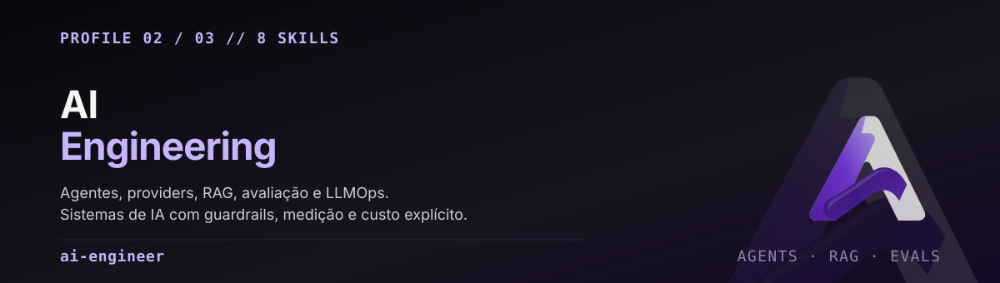

<p align="center">
  
</p>

<p align="center">
  <code>distribution.yaml</code> · <code>config.yaml</code> · <code>SOUL.md</code> · 8 skills · v0.1.0
</p>

**Build useful, secure and measurable AI systems.** Task contracts, model/tool integration,
retrieval, evaluation and production operations. Prefer bounded behavior over theatrical autonomy.

Este é o perfil que trata um sistema de IA como **sistema**, não como prompt. Ele exige contrato
de tarefa, baseline, caso held-out e evidência observável antes de promover qualquer coisa — e
recusa confundir julgamento do modelo com prova de produção.

---

## Use quando

| Situação | Skill que conduz |
|---|---|
| Desenhar um agente com tools, estado, handoffs e regra de parada | `aie-agent-architecture` |
| Escolher/rotear provider, fallback, compatibilidade | `aie-model-routing` |
| Ingestão de conhecimento, recall, memória persistente | `aie-rag-memory` |
| Endurecer agente, MCP tool ou app LLM contra abuso | `aie-agent-security` |
| Montar suíte de avaliação antes de promover um prompt | `aie-agent-evaluation` |
| Instrumentar, lançar e operar um serviço LLM | `aie-llmops-observability` |
| Estruturar uma capacidade operacional recorrente | `agent-folder-architect` |
| Adotar um repositório com escopo e trust boundary explícitos | `project-context-architect` |

---

## O que diferencia este perfil

**Avaliação antes de promoção.** `aie-agent-evaluation` exige baseline, casos held-out e
evidência observável. Julgamento do modelo **não** é prova de produção — e mock test **não** é
avaliação.

**Custo e latência são variáveis de design.** `aie-model-routing` e `aie-llmops-observability`
tratam qualidade, latência, custo e fronteira de dado como restrições simultâneas. Trocar de
modelo em silêncio, ou mandar dado para outro trust domain, não é otimização.

**Memória não é armazém irrestrito.** `aie-rag-memory` exige proveniência, controle de acesso,
retenção e avaliação de retrieval. Uma memória compartilhada entre clientes não é conveniência —
é vazamento.

**Guardrails antes da autonomia.** `aie-agent-security` modela ameaça de abuso de tool, injeção
de prompt e vazamento antes de plugar uma tool sensível ou permitir execução autônoma.

**Parada explícita.** `aie-agent-architecture` exige regra de parada. Agente sem condição de
término não é autônomo, é descontrolado.

---

## As 8 skills

### Técnicas (6)

| Skill | Escopo |
|---|---|
| [`aie-agent-architecture`](skills/aie-agent-architecture/SKILL.md) | Sistemas de agente com objetivo, tools, estado, handoffs e regra de parada explícitos. Hermes, workflow com tool, orquestração. **Não** cria agente extra para tarefa determinística simples. |
| [`aie-model-routing`](skills/aie-model-routing/SKILL.md) | Rotas de provider/gateway, fallback e compatibilidade com qualidade, latência, custo e fronteira de dado mensuráveis. **Não** troca modelo em silêncio nem envia dado a outro trust domain. |
| [`aie-rag-memory`](skills/aie-rag-memory/SKILL.md) | RAG e memória persistente com proveniência, controle de acesso, retenção e avaliação de retrieval. **Não** trata memória como armazém irrestrito entre clientes. |
| [`aie-agent-security`](skills/aie-agent-security/SKILL.md) | Threat model e hardening de agente, tool MCP e app LLM contra abuso de tool, prompt injection e vazamento. Teste dentro de escopo autorizado. |
| [`aie-agent-evaluation`](skills/aie-agent-evaluation/SKILL.md) | Suíte de avaliação para prompt, tool, modelo e workflow com baseline, held-out e evidência. **Não** equipara julgamento de modelo a prova de produção. |
| [`aie-llmops-observability`](skills/aie-llmops-observability/SKILL.md) | Instrumentar, lançar e operar serviço LLM com qualidade, latência, custo, trace e recuperação. **Não** loga prompt sensível nem assume que saúde do modelo prova sucesso da tarefa. |

### Compartilhadas (2)

[`agent-folder-architect`](skills/agent-folder-architect/SKILL.md) e
[`project-context-architect`](skills/project-context-architect/SKILL.md) existem em
`shared-skills/` na raiz e são **geradas** para dentro deste profile. Não edite as cópias aqui.

---

## O ciclo que este perfil impõe

```text
contrato de tarefa → baseline → caso held-out → instrumentação
        ↓                                          ↓
   guardrail                              evidência observável
        ↓                                          ↓
      execução  ──────────────────────────→  promoção ou recusa
```

Nenhuma seta desse ciclo é opcional. É por isso que `aie-agent-evaluation` e
`aie-llmops-observability` existem como skills separadas de `aie-agent-architecture`: desenhar o
agente e provar que ele funciona são trabalhos distintos.

---

## Instalar

A partir da raiz do repositório, com um clone em caminho estável:

```sh
hermes profile install ./profiles/ai-engineer --name ai-engineer-lab
hermes -p ai-engineer-lab setup
hermes -p ai-engineer-lab chat
```

Este diretório é **fonte de distribution**, não um home Hermes ativo. Nenhuma credencial de
provider, chave de modelo ou runtime state acompanha o pacote. O sufixo `-lab` é ilustrativo.

Para outro trust domain, instale um nome novo a partir deste template — nunca clone um profile vivo.

---

## Configuração de partida

`config.yaml` traz defaults conservadores. São política de configuração, **não** um sandbox:

```yaml
approvals:
  mode: manual
  cron_mode: deny
  unattended_mode: deny
  single_query_mode: deny
skills:
  auto_load: [agent-folder-architect]
  write_approval: true
memory:
  write_approval: true
```

O provider é escolha sua no `setup`. Não há chave, modelo obrigatório nem rota default para
nenhum endpoint.

---

## Baseline e qualificação

O manifest declara **feature floor v0.22.5** — piso, não garantia de paridade entre releases.
A qualificação real está em [`reports/QUALIFICATION.md`](../../reports/QUALIFICATION.md).

Atenção especial a um limite que este perfil torna explícito: **os 78 casos de
`evals/cases.jsonl` estão escritos e não foram executados.** Um dataset de avaliação não é uma
avaliação. Ver [KNOWN-LIMITS](../../docs/KNOWN-LIMITS.md).

---

## English summary

**Principal AI Systems Engineer.** Build AI systems that are useful, secure and measurable.

- **6 technical skills**: agent architecture, model routing, RAG/memory, agent security,
  evaluation, LLMOps observability. Plus the 2 generated shared skills.
- **Evaluation before promotion**: baseline, held-out cases, observable evidence. A model's
  own judgment is not production proof, and a mock test is not an evaluation.
- **Cost and latency are design constraints**, not afterthoughts. Silent model swaps and
  cross-trust-domain data moves are not optimizations.
- **Memory is not an unrestricted store**: provenance, access control, retention and retrieval
  evaluation are required.
- **Guardrails before autonomy**, and every agent declares a stopping rule.
- **Not** an official Nous Research release, and **not** a per-profile sandbox.
- The 78 evaluation cases in `evals/` are written but **not executed**.

Baseline Hermes v0.22.5. Full base: [repository README](../../README.md).
