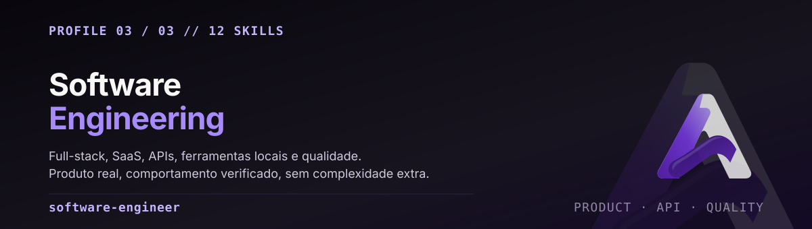

<p align="center">
  
</p>

<p align="center">
  <code>distribution.yaml</code> · <code>config.yaml</code> · <code>SOUL.md</code> · 12 skills · v0.1.0
</p>

**Turn a real product or engineering need into working, maintainable software with verified
behavior.** Design, implement, debug, test and evolve complete solutions without unnecessary
complexity.

Este é o perfil mais amplo da base: 10 skills técnicas cobrindo o ciclo de produto, mais as 2
compartilhadas. Ele existe porque a maior parte do trabalho real não cabe em uma disciplina —
uma feature atravessa contrato de API, banco, UI, teste e release.

O viés é explícito: **diff focado, comportamento verificado, zero expansão de escopo silenciosa.**

---

## Use quando

| Situação | Skill que conduz |
|---|---|
| Repositório desconhecido, preciso entender antes de mexer | `swe-codebase-discovery` |
| Produto novo, refactor consequente, decisão de fronteira | `swe-architecture-design` |
| Implementar uma feature ou corrigir bug de ponta a ponta | `swe-vertical-slice-delivery` |
| Endpoint, schema, migração, integração | `swe-api-data-contracts` |
| Provar que a mudança funciona antes de dizer que funciona | `swe-quality-verification` |
| Autenticação, autorização, fluxo de dado, sessão | `swe-application-security` |
| Build, versão, dependência, prontidão de release | `swe-release-maintenance` |
| Interface web, layout responsivo, estado de erro | `swe-web-experience` |
| Multi-tenant, entitlement, cobrança | `swe-saas-engineering` |
| CLI, app desktop, integração de SO, empacotamento | `swe-local-crossplatform` |
| Estruturar capacidade operacional recorrente | `agent-folder-architect` |
| Adotar um repositório com escopo explícito | `project-context-architect` |

---

## O que diferencia este perfil

**Descoberta antes de edição.** `swe-codebase-discovery` rastreia caminho de execução e de dado
reais. Diagrama especulado a partir de nome de pasta não é entendimento.

**Fatiar na vertical, não na horizontal.** `swe-vertical-slice-delivery` entrega comportamento
funcionando através das camadas necessárias, com regression check e diff focado. Plano entregue
no lugar de implementação não conta.

**Prova em vez de confiança.** `swe-quality-verification` exige evidência real. Percentual de
cobertura não substitui teste; confiança do modelo não substitui teste.

**Segurança aplicada, não auditada.** `swe-application-security` implementa controle em
autenticação, autorização, entrada e sessão. Scanner **não** substitui controle aplicado.

**Rollback de código não desfaz dado.** `swe-api-data-contracts` trata migração como operação de
mão única: reverter o deploy não reverte a migração.

**Sem complexidade não pedida.** `swe-architecture-design` não impõe microserviço, DDD ou
framework sem evidência. `swe-saas-engineering` não adiciona tenancy a toda aplicação.

---

## As 12 skills

### Técnicas (10)

| Skill | Escopo |
|---|---|
| [`swe-codebase-discovery`](skills/swe-codebase-discovery/SKILL.md) | Inspecionar repositório desconhecido e rastrear caminho real de execução/dado antes de modificar. Onboarding, análise de impacto, legado. **Não** para diagrama especulado por nome de pasta. |
| [`swe-architecture-design`](skills/swe-architecture-design/SKILL.md) | Fronteira de aplicação, contrato e fluxo de dado a partir de requisito e atributo de qualidade. **Não** impõe microserviço, DDD ou framework sem evidência. |
| [`swe-vertical-slice-delivery`](skills/swe-vertical-slice-delivery/SKILL.md) | Feature ou bugfix limitado, através das camadas necessárias, com comportamento funcionando, regression check e diff focado. **Não** substitui implementação por plano nem expande escopo em silêncio. |
| [`swe-api-data-contracts`](skills/swe-api-data-contracts/SKILL.md) | Contrato de API e persistência com validação, autorização, consistência e migração segura. **Não** assume que rollback de código desfaz dado. |
| [`swe-quality-verification`](skills/swe-quality-verification/SKILL.md) | Check baseado em risco, teste de regressão e code review com evidência real. **Não** troca teste por confiança do modelo ou percentual de cobertura. |
| [`swe-application-security`](skills/swe-application-security/SKILL.md) | Segurança de aplicação em autenticação, autorização, fluxo de dado e fronteira de sessão. **Não** afirma que scanner ou prompt seguro substitui controle aplicado. |
| [`swe-release-maintenance`](skills/swe-release-maintenance/SKILL.md) | Build, pacote, mudança versionada e release mantenível com evidência de compatibilidade e recuperação. **Não** publica nem descarta mudança do usuário automaticamente. |
| [`swe-web-experience`](skills/swe-web-experience/SKILL.md) | Interface web com fluxo real, layout responsivo, interação acessível e estado de loading/erro explícito. **Não** trata screenshot ou dado mockado como funcionalidade. |
| [`swe-saas-engineering`](skills/swe-saas-engineering/SKILL.md) | Capacidade SaaS com isolamento de tenant, autorização, ciclo de vida e regra comercial. **Não** adiciona tenancy ou assinatura a toda aplicação. |
| [`swe-local-crossplatform`](skills/swe-local-crossplatform/SKILL.md) | Ferramenta local, CLI, app desktop, integração de SO limitada, persistência e empacotamento. **Não** assume paridade de SO em segurança, path ou packaging. |

### Compartilhadas (2)

[`agent-folder-architect`](skills/agent-folder-architect/SKILL.md) e
[`project-context-architect`](skills/project-context-architect/SKILL.md) existem em
`shared-skills/` na raiz e são **geradas** para dentro deste profile. Não edite as cópias aqui.

---

## O caminho padrão de uma mudança

```text
descobrir  →  desenhar (só se consequente)  →  fatiar verticalmente
    ↓                                                    ↓
caminho real                                    contrato + autorização
                                                         ↓
                                          teste com evidência → release
```

Nem toda mudança percorre tudo. Um bugfix pequeno pode ir de descoberta direto para o slice
vertical com um regression test. O que este perfil não permite é pular a **verificação** e
declarar sucesso.

---

## Instalar

A partir da raiz do repositório, com um clone em caminho estável:

```sh
hermes profile install ./profiles/software-engineer --name software-engineer-lab
hermes -p software-engineer-lab setup
hermes -p software-engineer-lab chat
```

Este diretório é **fonte de distribution**, não um home Hermes ativo. Nenhuma credencial ou
runtime state acompanha o pacote. O sufixo `-lab` é ilustrativo.

Para outro trust domain, instale um nome novo a partir deste template — nunca clone um profile vivo.

---

## Configuração de partida

`config.yaml` traz defaults conservadores. São política de configuração, **não** um sandbox:

```yaml
approvals:
  mode: manual
  cron_mode: deny
  unattended_mode: deny
  single_query_mode: deny
skills:
  auto_load: [agent-folder-architect]
  write_approval: true
memory:
  write_approval: true
```

---

## Baseline e qualificação

O manifest declara **feature floor v0.22.5** — piso, não garantia de paridade entre releases.
A qualificação real está em [`reports/QUALIFICATION.md`](../../reports/QUALIFICATION.md), e o
corpus de avaliação de modelo em [`evals/cases.jsonl`](../../evals/cases.jsonl) inclui pelo menos
30 casos técnicos deste perfil — **escritos, não executados**. Ver
[KNOWN-LIMITS](../../docs/KNOWN-LIMITS.md).

---

## English summary

**Principal Software Engineer and Full-Stack Product Engineer.** The broadest profile in the base:
10 technical skills covering the product cycle, plus the 2 generated shared skills.

- **Discovery before editing**: trace the real execution and data path; a diagram inferred from
  folder names is not understanding.
- **Slice vertically, not horizontally**: working behavior across the layers a feature needs,
  with a regression check and a focused diff. A plan is not an implementation.
- **Proof over confidence**: real evidence. Coverage percentage does not replace a test, and
  neither does model confidence.
- **Security applied, not audited**: enforced controls in auth, authz, input and session
  handling. A scanner does not replace an enforced control.
- **A code rollback does not reverse a data migration** — migrations are one-way operations.
- **No unrequested complexity**: no microservices, DDD or framework without evidence; no tenancy
  bolted onto every application.
- **Not** an official Nous Research release, and **not** a per-profile sandbox.

Baseline Hermes v0.22.5. Full base: [repository README](../../README.md).
